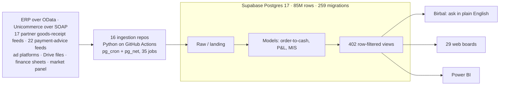

### Keyur Makwana — analytics engineer, Ahmedabad

Self-taught. For nearly four years I've run the whole analytics stack at a quick-commerce FMCG brand,
alone: pipelines, a governed Postgres warehouse, the P&L in SQL, dashboards, and an ask-your-data
assistant on the Claude API. Open to analytics engineer roles, remote or relocating.

**Portfolio:** [illusionist-creator.github.io/Portfolio](https://illusionist-creator.github.io/Portfolio/) ·
**LinkedIn:** [keyur-makwana](https://www.linkedin.com/in/keyur-makwana-450337197)

#### The warehouse I run at work

#### Things I built on public data

| Project | What it is | Stack |
|---|---|---|
| [India Card Monitor](https://illusionist-creator.github.io/rbi-payments-data/) · [code](https://github.com/illusionist-creator/rbi-payments-data) | RBI's bank-wise card statistics and NPCI's UPI tables joined month by month since 2011. Refreshes itself twice a week; a dbt test suite has to pass before anything is published ([docs and lineage](https://illusionist-creator.github.io/rbi-payments-data/dbt/)) | Python, dbt, DuckDB, D3, GitHub Actions |
| [shelf.monitor](https://qcomm-shelf-monitor.vercel.app/) · [code](https://github.com/illusionist-creator/qcomm-shelf-monitor) | Who shoppers see first on Blinkit, Zepto, Instamart and Flipkart Minutes: rank, paid slots, price and stock, every three hours | Playwright, BigQuery, DuckDB-WASM, React |
| [SQLQuest](https://illusionist-creator.github.io/sqlquest/) · [code](https://github.com/illusionist-creator/sqlquest) | Learn SQL by writing it: 64 challenges from SELECT to window functions, checked against a real database in the browser | JavaScript, SQLite (WASM) |
| [Growth Forecaster](https://keyurtbd.shinyapps.io/growth_forecaster/) · [code](https://github.com/illusionist-creator/sale-forecaster) | Monthly sales to a fiscal-year P&L forecast, with ETS / ARIMA ranges, scenarios and an Excel board pack | R Shiny |
| [GitHub Actions Monitor](https://github-action-monitor.vercel.app/) · [code](https://github.com/illusionist-creator/github_action_monitor) | Cross-repo CI health, flaky failures and compute spend in one place | JavaScript |

The `*-grn` repos are small scrapers that turn each retail partner's goods-receipt notes into one clean format.

**Kit:** SQL · Python · PostgreSQL · dbt · BigQuery · DuckDB · GitHub Actions · Playwright · Power BI · Tableau · D3 · Claude API
